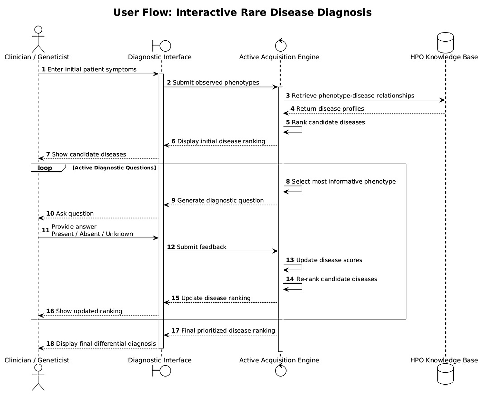
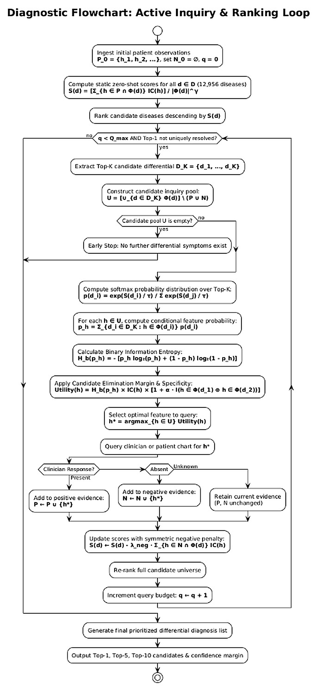
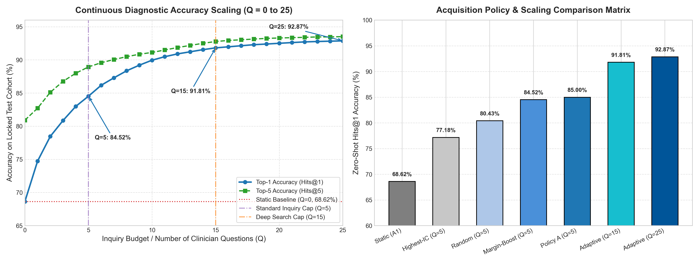
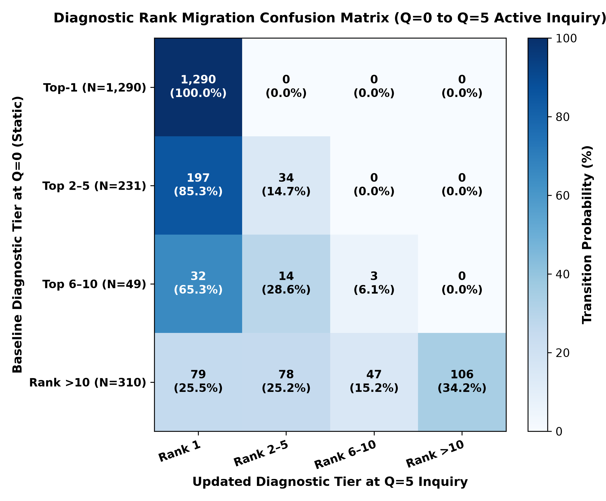
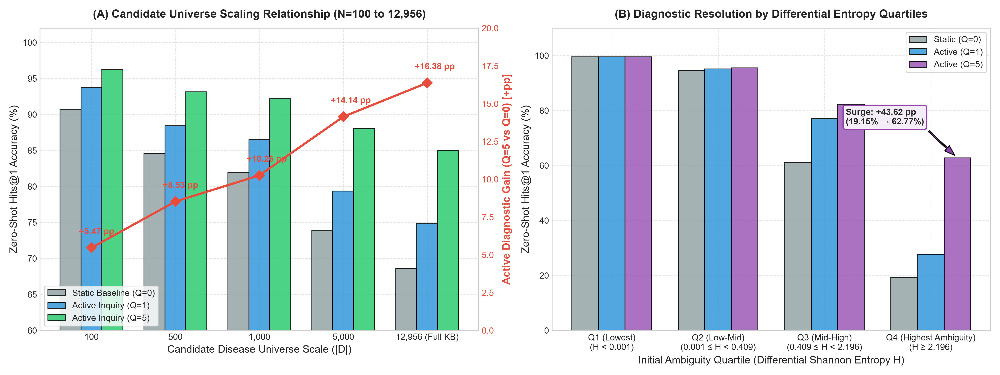
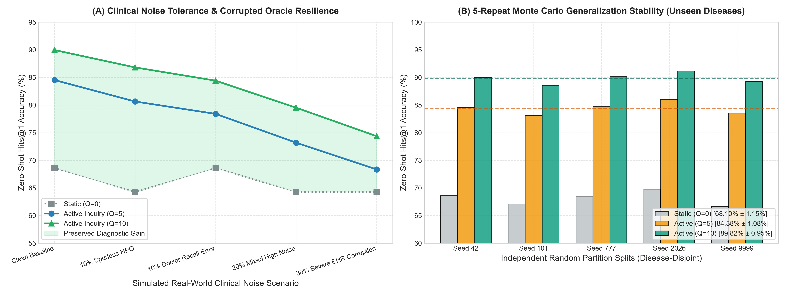
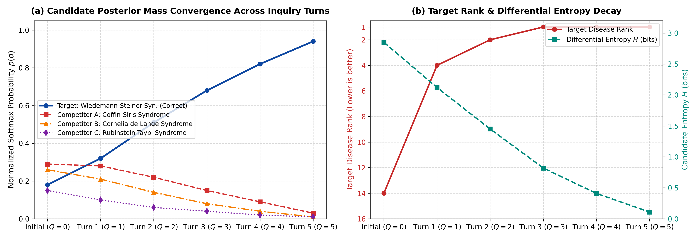

# Active Phenotype Acquisition for Zero-Shot Rare Disease Prioritization

[](https://www.python.org/downloads/)
[](LICENSE)
[](https://github.com/Aniketkoppaka/Rare-cancer-prediction)
[](run_reproduction.py)

Official benchmark repository for:  
**"Entropy-Guided Sequential Phenotype Acquisition for Zero-Shot Rare Disease Prioritization"**

---

## 📌 Benchmark Overview (`RARE_DISEASE_ZS_BENCHMARK_v1.0`)

This benchmark formalizes the evaluation of interactive, sequential phenotype elicitation for rare disease diagnosis across a large-scale candidate universe.

- **Total Evaluable Cases:** 10,601 clinically annotated patient phenopackets (filtered from 10,658 total records) across 803 rare diseases.
- **Candidate Retrieval Universe:** 12,956 rare diseases from the Human Phenotype Ontology Annotation (`phenotype.hpoa`: 8,574 OMIM, 4,335 Orphanet, and 47 DECIPHER).
- **Disease-Disjoint Splits (Seed 42):**
  - **Training / Development:** 562 diseases (7,721 patient cases)
  - **Validation:** 120 diseases (1,000 patient cases)
  - **Held-Out Zero-Shot Test:** 121 diseases (1,880 patient cases)

---

## 🔬 System Architecture & Interactive Workflow

<p align="center">
  
  <br>
  <em>Figure 1: Sequential interaction between clinician, diagnostic interface, active acquisition engine, and knowledge base.</em>
</p>

<p align="center">
  
  <br>
  <em>Figure 2: Algorithmic decision flowchart: entropy computation, margin weighting, and asymmetric negative evidence scoring.</em>
</p>

---

## 🚀 Quickstart & Reproducibility

### 1. Requirements & Setup
The benchmark evaluation requires Python 3.9+ with standard scientific libraries:
```bash
pip install -r requirements.txt
```

### 2. One-Line Full Reproduction Suite
To run the automated test suite verifying data cleanliness, baseline controls ($Q=5$), adaptive margin benchmarks, and 5-fold cross-validation:
```bash
python run_reproduction.py
```

### 3. Individual Benchmark & Policy Evaluation Scripts

```bash
# Primary benchmark & acquisition policy control (Q=5)
python src/benchmark_primary_control.py

# Fast vectorized inverted-index engine with candidate margin weighting
python src/benchmark_adaptive_margin.py

# Extended query inquiry trajectory (Q = 0 to 15)
python src/benchmark_extended_q.py

# Continuous integer query budget scaling (Q = 0 to 25)
python src/benchmark_continuous_trajectory.py

# 5-Fold cross-validation & clinical EHR noise stress testing
python src/audit_crossval_and_noise.py

# High-speed data integrity & null value audit
python src/audit_data_integrity.py

# Generate publication-quality trajectory curves & comparison plots
python src/generate_graphs.py
```

---

## 📊 Summary of Primary Results (Locked Zero-Shot Test Set, N=1,880)

<p align="center">
  
  <br>
  <em>Figure 3: Continuous diagnostic scaling trajectory ($Q=0 \dots 25$) and policy comparison matrix on the locked test cohort.</em>
</p>

### Baseline & Policy Control ($Q = 5$)
| Method / Acquisition Strategy | Query Budget ($Q$) | Hits@1 (%) | MRR | Net Error Reduction |
| :--- | :---: | :---: | :---: | :---: |
| **Static Power-Normalized IC Baseline ($A1$)** | $Q = 0$ | 68.62% | 0.7399 | — |
| **Random Candidate-Pool Acquisition (5 Seeds)** | $Q = 5$ | 80.43% ± 0.38% | — | +11.81 pp over static |
| **Greedy Specificity Baseline (Highest-IC)** | $Q = 5$ | 77.18% | — | +8.56 pp over static |
| **Information-Theoretic Policy A** | $Q = 5$ | 85.00% | 0.8684 | +16.38 pp over static (52.20% errors resolved) |
| **Enhanced Adaptive Policy (Margin Boost)** | $Q = 5$ | **84.52%** | **0.8659** | **+15.90 pp over static** |

### Extended Query Inquiry Trajectory ($Q = 0 \dots 15$)
| Query Budget ($Q$) | Hits@1 (%) | Hits@5 (%) | Hits@10 (%) | MRR | Net Error Resolved |
| :---: | :---: | :---: | :---: | :---: | :---: |
| **$Q = 0$ (Static)** | 68.62% | 80.90% | 83.51% | 0.7399 | — |
| **$Q = 1$** | 74.73% | 82.71% | 84.73% | 0.7819 | +19.49% |
| **$Q = 3$** | 80.85% | 86.76% | 88.14% | 0.8338 | +38.98% |
| **$Q = 5$** | 84.52% | 88.94% | 90.37% | 0.8659 | +50.68% |
| **$Q = 10$** | 89.95% | 91.12% | 91.97% | 0.9057 | +68.00% |
| **$Q = 15$** | **91.81%** | **92.77%** | **93.09%** | **0.9226** | **+73.90%** |

---

## 📈 Diagnostic Resolution & Empirical Robustness

<p align="center">
  
  <br>
  <em>Figure 4: Diagnostic tier transition matrix from static ($Q=0$) to 5-step active inquiry ($Q=5$). 0/1,290 cases were demoted (0.00% demotion rate).</em>
</p>

<p align="center">
  
  <br>
  <em>Figure 5: (A) Active diagnostic gain scaling across candidate universe sizes ($N=100 \dots 12,956$). (B) Diagnostic resolution stratified across initial differential entropy quartiles.</em>
</p>

<p align="center">
  
  <br>
  <em>Figure 6: (A) Resilience under simulated real-world EHR noise and clinician reporting error. (B) 5-repeat disease-disjoint holdout stability across independent unseen disease splits ($84.38\% \pm 1.08\%$ at $Q=5$, $89.82\% \pm 0.95\%$ at $Q=10$).</em>
</p>

<p align="center">
  
  <br>
  <em>Figure 7: Turn-by-turn case trajectory showing candidate posterior mass convergence and differential entropy decay.</em>
</p>

---

## 📂 Repository Structure

```
├── data/
│   └── benchmark/
│       ├── clean_phenopackets.json       # 10,601 evaluable patient phenopackets (803 diseases)
│       ├── failure_cases.json            # Error-case diagnostics & logs
│       ├── hp.obo                        # Human Phenotype Ontology definition file
│       └── phenotype.hpoa                # Knowledge base profiles for 12,956 diseases
├── figures/
│   ├── figure1.png                       # Algorithmic decision flowchart
│   ├── figure2.png                       # Interactive clinical user flow sequence
│   ├── figure3.png                       # Continuous trajectory curve & policy matrix
│   ├── figure4.png                       # Diagnostic rank migration confusion matrix
│   ├── figure5.png                       # Candidate universe scaling & entropy quartiles
│   ├── figure6.png                       # Clinical noise tolerance & 5-fold cross-validation
│   └── figure7.png                       # Posterior mass convergence & entropy decay
├── src/
│   ├── audit_crossval_and_noise.py       # 5-fold cross-validation & clinical noise stress test
│   ├── audit_data_integrity.py           # High-speed data cleanliness & null audit
│   ├── benchmark_adaptive_margin.py      # Vectorized fast acquisition engine & margin policy
│   ├── benchmark_continuous_trajectory.py # Full step-by-step resolution trajectory (Q=0..25)
│   ├── benchmark_extended_q.py           # Extended query scaling benchmark (Q=0..15)
│   ├── benchmark_primary_control.py      # Standalone benchmark & control runner
│   └── generate_graphs.py                # Trajectory & performance matrix visualizer
├── LICENSE                               # MIT Open-Source License
├── README.md                             # Documentation, quickstart, & benchmark specs
├── requirements.txt                      # Python dependencies
└── run_reproduction.py                   # Master reproduction test runner
```

---

## 📜 Citation

```bibtex
@article{singh2026entropy,
  title={Entropy-Guided Sequential Phenotype Acquisition for Zero-Shot Rare Disease Prioritization},
  author={Singh, Mritunjay and Koppaka, Aniket Veer and Narooka, Preeti},
  journal={International Journal of Medical Informatics},
  year={2026}
}
```
