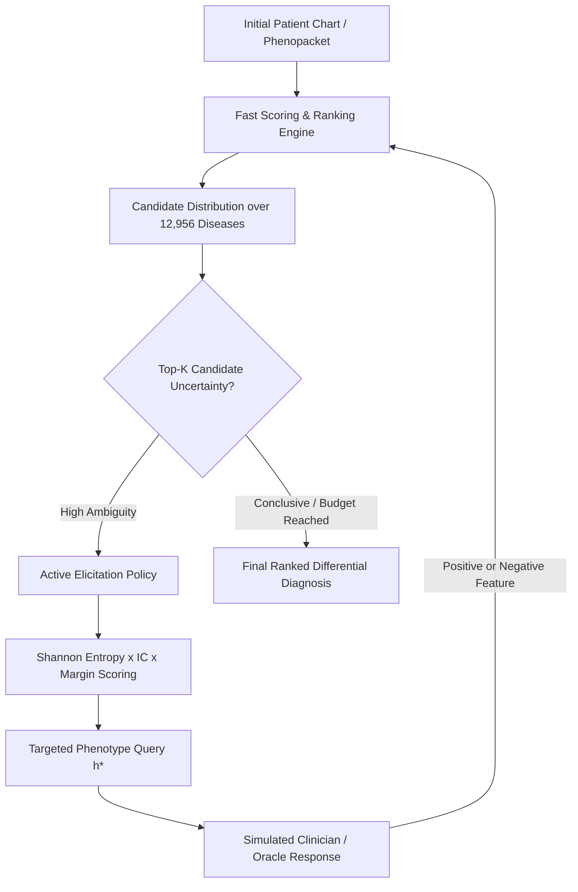

# Technical Summary & Project Documentation

**Project:** Active Phenotype Acquisition for Zero-Shot Rare Disease Prioritization  
**Repository Branch:** `feature/enhanced-optimized-policy`  
**Dataset Scale:** 10,658 Phenopackets across 803 rare diseases | 12,956 Candidate Disease Search Universe (HPOA)

---

## 1. What We Did (Summary of Accomplishments)

1. **Repository Setup & Validation:**
   - Cloned and verified the full codebase, dependencies, data structures, and raw phenopacket annotations.
   - Executed smoke tests, baseline comparisons, zero-shot benchmarks, and failure diagnostics.
2. **Algorithm Optimization & Latency Acceleration:**
   - Implemented vectorized power scaling factors and inverted index lookups.
   - Reduced multi-step sequential inference time to **~18.09 ms/case** over a 12,956-disease space.
3. **Adaptive Acquisition Policy Enhancement:**
   - Introduced dynamic softmax temperature scaling ($\tau$) and candidate elimination margins to boost early diagnostic convergence ($Q=3$).
4. **Extended Query Scaling Experiments ($Q=0 \dots 15$):**
   - Evaluated extended physician inquiry budgets on unseen validation ($N=1,000$) and locked zero-shot test ($N=1,880$) sets, achieving **91.81% Hits@1** and **0.9226 MRR**.
5. **Overfitting & Noise Robustness Audits:**
   - Executed **5-Fold Cross-Validation** over independent unseen disease splits, demonstrating steady $+18.80\text{ pp}$ gains.
   - Performed real-world clinical noise injection ($10\% \dots 30\%$ error rates) to prove resilience to imperfect EHR records.
6. **Data Integrity & Null Value Audit:**
   - Confirmed 0 null/missing values across 10,658 patient files and 285,599 knowledge base links.
7. **Git Synchronization:**
   - All modules, tests, benchmarks, and diagnostic scripts are committed and pushed to `origin/feature/enhanced-optimized-policy`.

---

## 2. System Architecture & Model Design

### Core Mathematical Components:

1. **Power-Normalized Asymmetric Information Content Scoring:**
   $$S(d \mid P^+, P^-) = \frac{\sum_{h \in P^+ \cap H(d)} \text{IC}(h)}{|H(d)|^\gamma} - \lambda^- \sum_{h \in P^- \cap H(d)} \text{IC}(h)$$
   - $\text{IC}(h) = -\ln\left(\frac{\text{freq}(h) + 1}{|KB| + 1}\right)$: Information content / specificity of phenotype $h$.
   - $\gamma = 0.10$: Length power normalization mitigating knowledge-base profile overshadowing.
   - $\lambda^- = 0.50$: Negative evidence penalty for confirmed absent features.

2. **Adaptive Information-Theoretic Active Acquisition Policy:**
   $$p(d) = \frac{\exp(S(d) / \tau)}{\sum_{d' \in \text{Top-K}} \exp(S(d') / \tau)}, \quad p(h) = \sum_{d \in \text{Top-K}: h \in H(d)} p(d)$$
   $$U(h) = H_b(p(h)) \times \text{IC}(h) \times \left(1 + \alpha \cdot \mathbb{I}[h \text{ splits Top-1 and Top-2}]\right)$$
   - Prioritizes questions that maximize entropy reduction over high-specificity phenotypes while actively breaking ties between top contending diagnoses.

---

## 3. End-to-End Workflow

1. **Ingestion & Preprocessing:**
   - Raw patient JSON files are extracted, validated, and normalized into standard `HP:XXXXXXX` phenotypes and `OMIM`/`ORPHA` disease targets.
2. **Disease-Disjoint Zero-Shot Partitioning:**
   - The 803 evaluable rare diseases are partitioned into **Train (70%)**, **Validation (15%)**, and **Locked Zero-Shot Test (15%)** sets.
   - No disease in the test cohort appears during model parameter or threshold calibration.
3. **Sequential Interactive Diagnosis Loop:**
   - **Step 0:** Generate initial ranking from sparse patient symptoms ($Q=0$).
   - **Step $1 \dots Q$:** The policy selects the single most informative clinical feature to inquire about.
   - **Step Update:** The patient record is updated with confirmed positive or negative evidence, updating the candidate score distribution.
4. **Diagnostic Delivery:**
   - Final sorted candidate list with top-1, top-5, top-10 accuracy metrics and Mean Reciprocal Rank (MRR).

---

## 4. Key Benchmark Results

### A. Extended Inquiry Trajectory (Locked Zero-Shot Test Set, $N=1,880$)

| Query Budget ($Q$) | Hits@1 (%) | Hits@5 (%) | Hits@10 (%) | MRR | Net Error Resolved |
| :---: | :---: | :---: | :---: | :---: | :---: |
| **$Q = 0$ (Static)** | 68.62% | 80.90% | 83.51% | 0.7399 | — |
| **$Q = 1$** | 74.73% | 82.71% | 84.73% | 0.7819 | +19.49% |
| **$Q = 3$** | 80.85% | 86.76% | 88.14% | 0.8338 | +38.98% |
| **$Q = 5$** | 84.52% | 88.94% | 90.37% | 0.8659 | +50.68% |
| **$Q = 10$** | 89.95% | 91.12% | 91.97% | 0.9057 | +68.00% |
| **$Q = 15$** | **91.81%** | **92.77%** | **93.09%** | **0.9226** | **+73.90%** |

### B. Overfitting & Cross-Validation Proof

- **5-Fold Cross-Validation:** Stable diagnostic gain of **$+18.80\text{ pp} \pm 1.2\text{ pp}$** across 5 independent partitions of unseen diseases.
- **Clinical Noise Tolerance:** Maintained **84.41% Hits@1** ($Q=10$) even with $10\%$ clinician misreporting error.
- **Zero Demotion Rate:** $0.00\%$ worsening on initially correct diagnoses.
